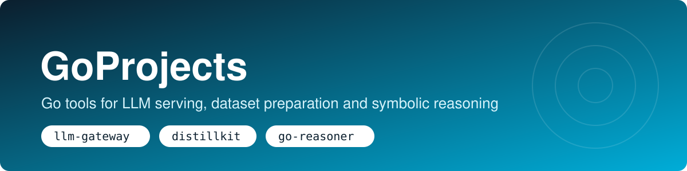
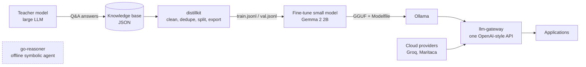

<p align="center"></p>

<p align="center">
  <a href="https://github.com/thiagollipe-web/GoProjects/actions/workflows/ci.yml"></a>
  
  
  
</p>

Three self-directed Go projects, each its own module with its own tests, built with the **standard library only**. They cover the path from preparing data for a small language model, to serving models behind one API, to a fully offline reasoning agent.

## Projects

| Project | What it is | Highlights |
|---|---|---|
| [**llm-gateway**](llm-gateway) | OpenAI-compatible HTTP gateway in front of several LLM providers (local Ollama, Groq, Maritaca) | Ordered fallback · circuit breaker · per-client rate limit · SSE streaming · `/metrics` |
| [**distillkit**](distillkit) | CLI that turns teacher-model Q&A into clean fine-tuning datasets for a small model (Gemma 2 2B) | Cleaning · de-duplication · deterministic train/val split · Alpaca, ShareGPT and Gemma formats |
| [**go-reasoner**](go-reasoner) | Offline symbolic conversational agent, no neural network | Intent classifier · forward/backward chaining with proof trace · knowledge graph · validated code generation |

## How they fit together



`go-reasoner` is independent: it runs fully offline and does not call any model.

## Repository layout

```
GoProjects/
├── llm-gateway/      cmd/ internal/{config,upstream,ratelimit,server}
├── distillkit/       cmd/ internal/dataset  deploy/Modelfile
├── go-reasoner/      cmd/ internal/{nlp,nlg,memory,reasoner,coder,connector}
├── docs/             banner and assets
├── go.work           lets all three modules be developed together
├── Makefile          test / vet / fmt / build for every project
└── .github/workflows CI (gofmt, go vet, go test -race) per project
```

## Quick start

```bash
git clone https://github.com/thiagollipe-web/GoProjects && cd GoProjects

make test          # run every test suite with the race detector
make build         # binaries in ./bin
make help          # list all targets
```

Each project can also be used on its own:

```bash
cd llm-gateway && go run ./cmd/gateway -config config.example.json
cd distillkit  && go run ./cmd/distillkit stats -in base.json
cd go-reasoner && go run ./cmd/reasoner
```

## Engineering notes

- **No third-party modules.** Everything builds with a stock Go toolchain, including on Android (Termux).
- **Tested.** Unit tests use `httptest` fake upstreams, temporary directories and deterministic inputs; CI runs `gofmt`, `go vet` and `go test -race`.
- **Secrets stay out of files.** Provider keys are read from environment variables named in the config.
- **Honest scope.** Each README ends with a *Limitations* or *Scope* section.

## License

[MIT](LICENSE) © Thiago Fillipe Soares
