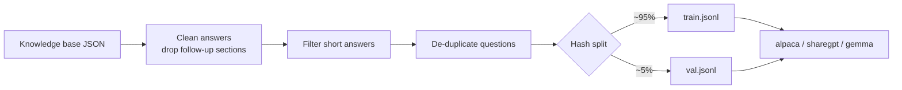

# distillkit

A small Go CLI that prepares **teacher-generated Q&A data for fine-tuning a small language model**. It is the data-preparation step of a knowledge-distillation workflow: a large model ("teacher") answers a curriculum of questions, and a small model (Gemma 2 2B) is fine-tuned on those answers and then served locally with Ollama.

Standard library only, no dependencies, single static binary.

## Workflow

1. **Collect** – a teacher model (Maritaca AI) answers a multi-discipline curriculum and the answers are stored in a JSON knowledge base (`{"artigos": {...}}`: question, area, answer).
2. **Prepare (this tool)** – clean, filter, de-duplicate, split and export the data.
3. **Fine-tune** – train the small model on the exported file (done outside this repository, e.g. Unsloth/Colab).
4. **Serve** – import the resulting GGUF into Ollama with [`deploy/Modelfile`](deploy/Modelfile) (Gemma 2 2B, Q4_K_M, Gemma chat template, 4096 context).




## What the tool does

- Removes the teacher's trailing "follow-up questions" sections from answers.
- Drops answers that are too short (`-min`, default 30 characters).
- De-duplicates questions after normalization (case, spacing, punctuation).
- Splits train/validation **deterministically** from a hash of the question, so re-running never moves an example between splits.
- Exports `alpaca`, `sharegpt` or `gemma` (Gemma 2 chat template with `<start_of_turn>`/`<end_of_turn>`) JSONL.
- Prints per-area counts and average answer length.

## Usage

```bash
go build -o bin/distillkit ./cmd/distillkit

bin/distillkit stats  -in enciclopedia_universal.json
bin/distillkit export -in enciclopedia_universal.json -format gemma -val 0.05 \
    -train train.jsonl -valout val.jsonl
```

Example output on a 1,659-article knowledge base spanning 17 disciplines:

```
total=1659 kept=1659 too_short=0 duplicates=0 avg_answer_chars=2217
format=gemma  train=1572 (train.jsonl)  validation=87 (val.jsonl)
```

## Tests

`go test -race ./...` covers cleaning, filtering, de-duplication, the three export formats (including the Gemma template), deterministic splitting and file export. CI runs `gofmt`, `go vet` and the tests.

## Scope

This repository contains the data tooling and the serving `Modelfile`. It does not contain the knowledge base, the training run or the model weights, and it makes no claims about the resulting model's quality.

## License

MIT
